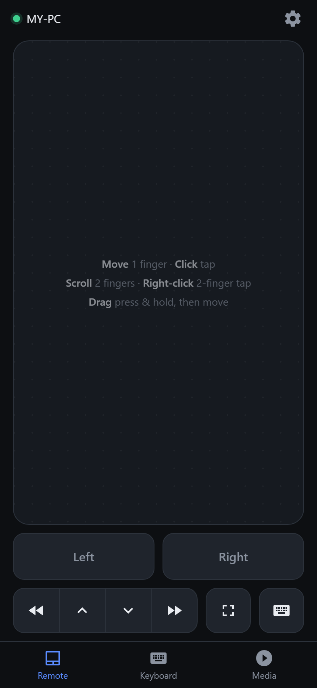
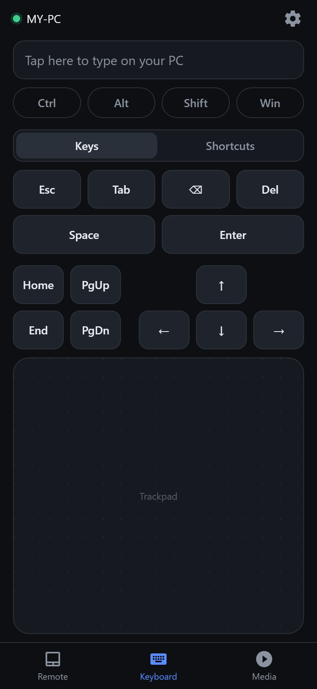
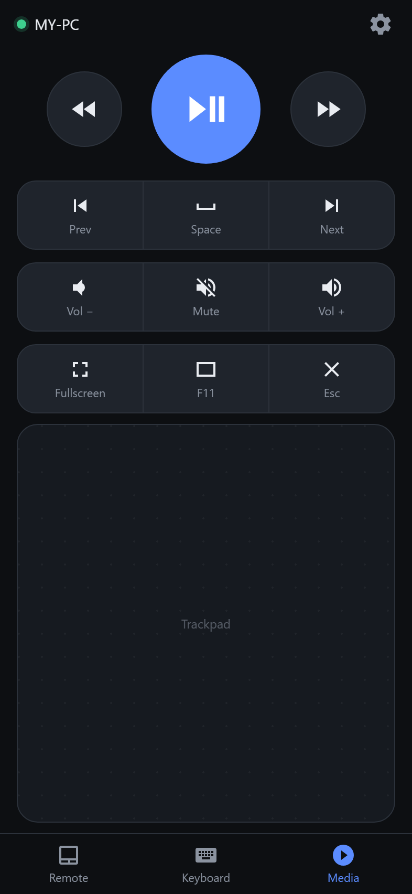
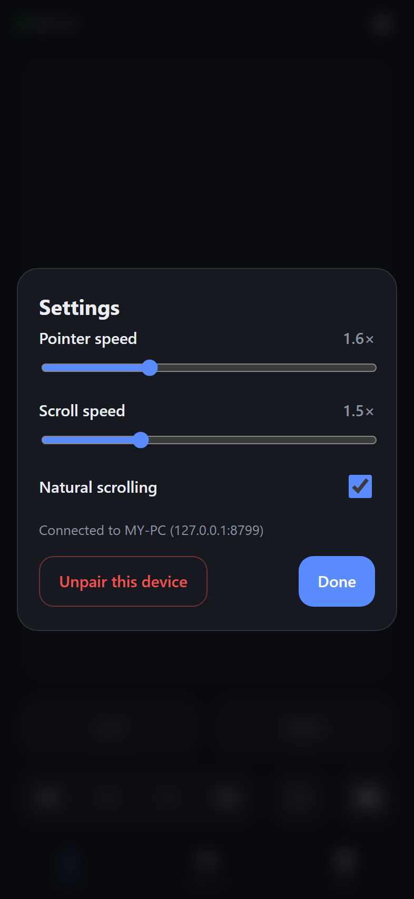

# PC Remote

**Turn your iPhone into a wireless trackpad, keyboard, and media remote for your Windows PC. You don't need to install an app on the phone.**


<p align="center">
  &nbsp;
  &nbsp;
  &nbsp;
  
</p>

Run one script on your PC and scan the QR code with your iPhone camera. Safari then becomes a low‑latency remote that works in any Windows app, which makes it handy for controlling a PC hooked up to a TV from the couch.

```
iPhone Safari  ──WebSocket (LAN)──▶  Python server on PC  ──SendInput──▶  Windows
 (web app)                            (aiohttp)                         (any app)
```

## Features

- **Remote:** one view with the trackpad, mouse buttons, seek, arrows, fullscreen and inline typing. Tap to click, two‑finger scroll with momentum, press‑and‑hold to drag, and right/middle click.
- **Keyboard:** type with the iOS keyboard, including autocorrect, dictation and emoji. Sticky Ctrl/Alt/Shift/Win keys and one‑tap shortcuts (copy/paste, Alt+Tab, Task View…).
- **Media:** play/pause, next/previous track, volume, seek and fullscreen. These work with YouTube, Netflix, Spotify, VLC and others.
- **QR‑code pairing:** scan once and the phone stays paired.
- **LAN only and token‑authenticated:** the server refuses connections from outside your network.
- **Installable:** add it to your Home Screen to get a full‑screen app.
- **Tiny:** about 1,400 lines of code and two dependencies (`aiohttp`, `qrcode`). There's no build step.

## Quick start

1. Install **[Python 3.10+](https://www.python.org/downloads/)**. Tick *Add python.exe to PATH* during setup.
2. Clone or [download](../../archive/refs/heads/main.zip) this repo, then double‑click **`start.bat`**. The first run creates a virtual environment and installs the dependencies.
3. If Windows Firewall asks, allow access on **Private networks**.
4. On your iPhone, **scan the QR code** in the console with the Camera app. Or open the printed URL (e.g. `http://192.168.1.50:8765`) and type the 6‑digit PIN.
5. Optional: in Safari tap **Share → Add to Home Screen** to get a full‑screen app icon. The Home Screen app keeps its own storage, so you'll pair it once more.

After that, start the server and open the page. Your phone is already paired.

## Using it

| Tab | What it does |
|---|---|
| **Remote** | Everything you need from the couch, in one view. 1 finger on the trackpad moves the pointer. **Tap** = left click, **2‑finger tap** = right click, **3‑finger tap** = middle click. **2‑finger swipe** scrolls with momentum, and **press & hold, then move** drags. The **Left/Right** buttons work like real mouse buttons: hold *Left* with your thumb and move with another finger to drag. Below them: **seek back/forward** (←/→), **up/down** (↑/↓), **fullscreen** (`F`) and **⌨**, which brings up the iOS keyboard right there, so you can type while you keep using the trackpad. Tap **Done** to hide it. |
| **Keyboard** | Tap the field and type with the iOS keyboard. Text is sent as you type, and backspace, dictation and emoji all work. **Ctrl/Alt/Shift/Win** are sticky: tap one, then type a letter or tap a key. **Keys** has editing and navigation keys; **Shortcuts** has common shortcuts grouped by Edit, Browser and Windows. Arrow, backspace and zoom keys repeat while held. |
| **Media** | Play/Pause, Prev/Next and Volume use the Windows media keys. **Seek** sends ←/→, which skips in YouTube, Netflix and VLC. **Fullscreen** sends `F`, the player shortcut in YouTube, Netflix and VLC. **F11** makes a browser window fullscreen. Volume buttons repeat while held. |

**Settings** (gear icon) has pointer speed, scroll speed, natural scrolling, and *Unpair this device*.

## Command‑line options

```
start.bat --port 8765           # port to listen on (default 8765)
start.bat --ip 192.168.1.50     # address to show in the URL/QR, e.g. if a VPN adapter gets picked
start.bat --host 0.0.0.0        # interface to bind (default: all)
start.bat --no-qr               # don't print the QR code
start.bat --list-devices        # show paired phones
start.bat --forget-devices      # revoke every paired phone
```

**Start with Windows:** press `Win+R`, type `shell:startup`, and put a shortcut to `start.bat` in that folder.

You can also run it without the batch file: `pip install -r requirements.txt`, then `python -m pcremote`.

## Security

- **Pairing:** a one‑time 6‑digit PIN is shown only on the PC. Pairing gives the phone a random 256‑bit token, which it keeps in local storage. The server stores only a SHA‑256 hash of each token, in `data/devices.json`. That folder is git‑ignored.
- **PIN rotation:** the PIN changes after every successful pairing and after 5 wrong guesses. Each wrong guess also waits 1 s, so brute force is impractical.
- **WebSocket auth:** every connection must present a valid token within 5 s or it's closed.
- **LAN only:** requests from non‑private IP addresses are refused.
- **No HTTPS:** traffic is unencrypted on your local network. iOS makes self‑signed certificates painful, and for a home LAN this is a reasonable trade‑off. **Don't run it on untrusted or public Wi‑Fi.**

## How it works

- **Input injection:** the server calls Win32 [`SendInput`](https://learn.microsoft.com/windows/win32/api/winuser/nf-winuser-sendinput) through `ctypes`, which is the same path a physical mouse and keyboard use. That's why it works in every app, not only browsers. Text goes through `KEYEVENTF_UNICODE`, so any character types correctly whatever the keyboard layout.
- **Latency:** there is one persistent WebSocket with `TCP_NODELAY`. Pointer and scroll deltas are collected and sent once per animation frame, so the socket never floods and the cursor tracks your finger. Buttons fire on touch‑down, not on click.
- **Reconnection:** a heartbeat every 2 s detects dead connections. When Safari comes back to the foreground, the page reconnects at once (iOS suspends background pages). Otherwise it retries with exponential backoff, capped at 3 s. If the connection drops while a mouse button is held, the server releases it.
- **iOS typing:** the text field holds invisible zero‑width sentinel characters. After every `input` event the page compares the field's old and new contents and sends backspaces plus the inserted text. This copes with autocorrect, dictation, held backspace and composed input, which per‑key events miss on iOS.

## Troubleshooting & limitations

- **Can't connect:** make sure the phone and PC are on the same network and that the firewall allows Python on *Private* networks. Some router "guest" or "AP isolation" modes block device‑to‑device traffic. If the printed address looks wrong (for example a VPN address), pass `--ip` with your PC's Wi‑Fi address.
- **Admin windows:** Windows blocks injected input into apps running as Administrator (Task Manager, some installers and games) unless PC Remote is also run as Administrator. The UAC prompt and the lock screen can't be controlled, by design.
- **Pointer acceleration:** cursor motion goes through Windows' *Enhance pointer precision* setting, the same as a real mouse. Adjust pointer speed in Settings.
- **Pairing per app:** Safari and a Home Screen web app keep separate storage, so each needs pairing once.
- **Compatibility:** built and tested on Windows 11 with iPhone Safari. It only uses standard Win32 APIs, so Windows 10 will probably work too, and other mobile browsers may work, but neither has been tested.

## Project layout

```
pcremote/
  server.py      HTTP + WebSocket server, pairing/auth, message handling
  winput.py      ctypes SendInput wrapper (mouse, keys, unicode text)
  static/        the phone web app (index.html, app.js, style.css, icons)
start.bat        one-click launcher (creates .venv on first run)
requirements.txt aiohttp, qrcode
```

## License

[MIT](LICENSE)
